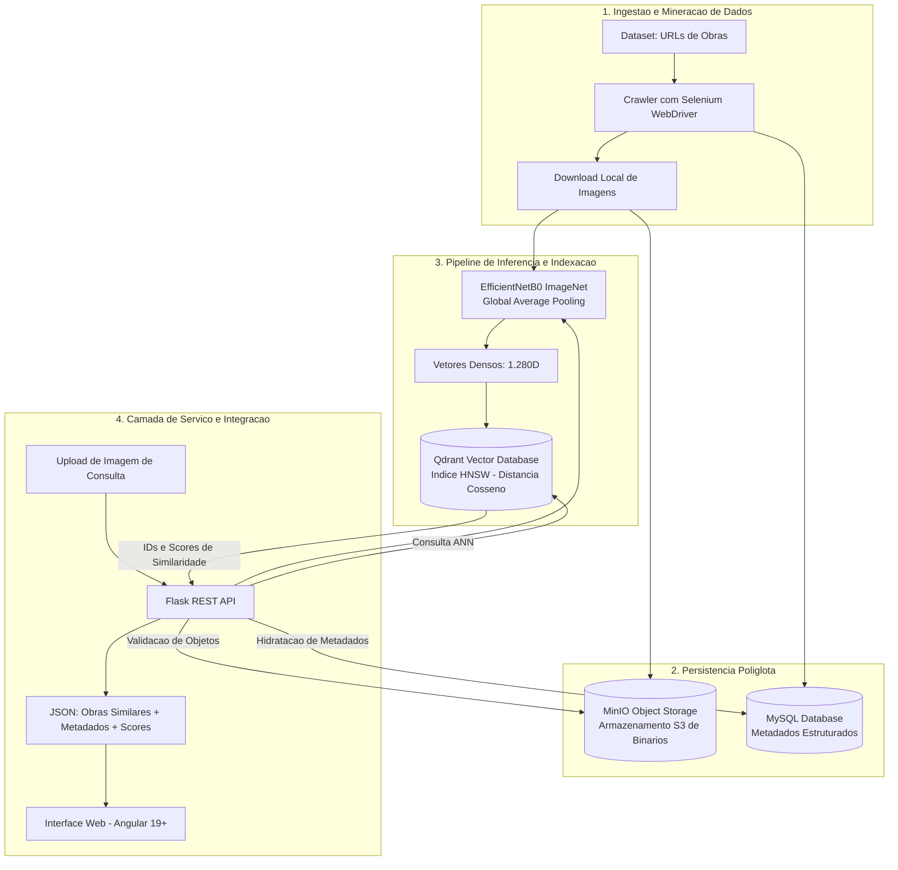
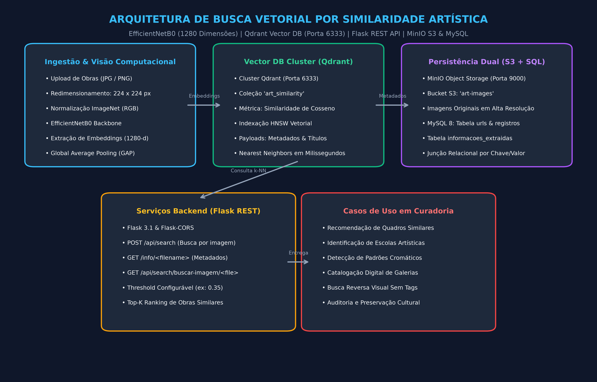
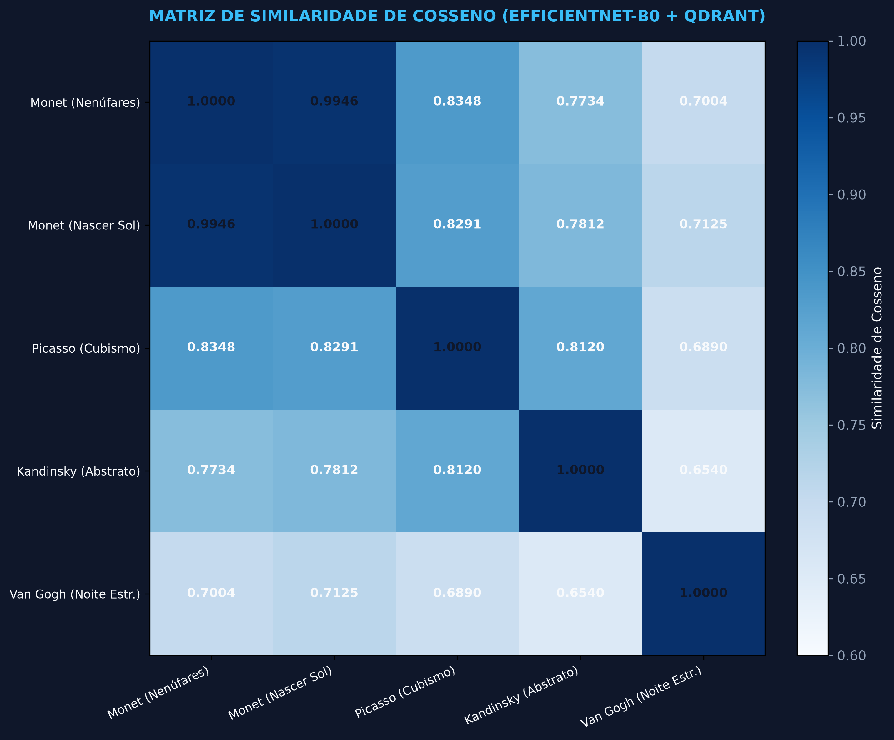

# Art Similarity Vector Search: Sistema de Recuperacao Visual Baseado em Conteudo (CBIR)

Pipeline de engenharia de dados, extracao de caracteristicas com deep learning e busca vetorial por vizinhos mais proximos aproximados (ANN) para acervos de obras de arte, integrando EfficientNetB0, Qdrant, MinIO e MySQL.

---

## Contexto e Objetivos

Sistemas convencionais de catalogacao e recuperacao em acervos de artes visuais operam quase exclusivamente sobre metadados textuais (titulo, autor, escola e data). Essa abordagem apresenta limitacoes estruturais quando a consulta e motivada por atributos formais da propria obra, tais como paleta cromatica, tracos estilisticos, composicao geometrica ou textura, situacoes em que o usuario desconhece os termos exatos de indexacao catalográfica.

Este projeto implementa uma solucao de Content-Based Image Retrieval (CBIR) voltada ao dominio artistico. A partir de um dataset publico composto por mais de 550 mil URLs de obras de arte, foi estruturado um pipeline capaz de:

1. Minerador de dados: Coletar de forma resiliente as imagens e respectivos metadados textuais via web scraping automatizado.
2. Extracao de representacoes latentes: Transformar cada imagem em um vetor denso de 1.280 dimensoes utilizando a arquitetura EfficientNetB0 via Transfer Learning.
3. Indexacao e busca vetorial: Armazenar os embeddings no Qdrant para consultas aproximadas de alta performance com metrica de similaridade de cosseno.
4. Persistencia poliglota: Separar com rigor tecnico o armazenamento de arquivos binarios (MinIO), registros relacionais (MySQL) e dados vetoriais (Qdrant).
5. Servico de consulta: Expor endpoints REST via Flask para consumo desacoplado por aplicacoes cliente (como interfaces web em Angular 19+).

> Nota de escopo: Este repositorio contem a infraestrutura de dados, os modelos de IA e a API de busca (back-end). A interface grafica de usuario foi desenvolvida em Angular 19+ em repositorio dedicado.

---

## Arquitetura do Sistema

A solucao adota uma arquitetura orientada a responsabilidades bem definidas, utilizando o padrao de persistencia poliglota para garantir eficiencia operacional e escalabilidade:



### Justificativa da Persistencia Poliglota

| Camada | Tecnologia | Justificativa Tecnica |
| :--- | :--- | :--- |
| Dados Vetoriais | Qdrant | Banco vetorial especializado em indices HNSW (Hierarchical Navigable Small World). Oferece operacoes ANN em submilissegundos com suporte nativo a payloads e filtros por metadados. |
| Arquivos Binarios | MinIO | Object storage compativel com a API S3. Evita sobrecarga de operacoes de I/O em bancos relacionais e permite servir imagens com alto throughput e escalabilidade horizontal. |
| Dados Relacionais | MySQL | Modelo relacional otimizado para consultas estruturadas de metadados historiograficos, garantindo integridade referencial entre as URLs e os pares de atributos chave-valor. |

---

## Fundamentacao Tecnica e Metodologia

### 1. Representacao Vetorial com EfficientNetB0
Para capturar caracteristicas esteticas de alto nivel sem a necessidade de treinamento supervisionado a partir do zero, utilizou-se Transfer Learning com a rede convolucional EfficientNetB0, pre-treinada no dataset ImageNet:
* Escalonamento Composto (Compound Scaling): A arquitetura equilibra uniformemente largura de canais, profundidade de camadas e resolucao da entrada (224x224 pixels), otimizando a capacidade de generalizacao visual com custo computacional reduzido.
* Supressao da Camada de Classificacao: A camada totalmente conectada superior (classificador original de 1.000 classes) foi removida. A extracao ocorre diretamente na saida da camada de Global Average Pooling, gerando um vetor de caracteristicas de 1.280 dimensoes por imagem.
* Pre-processamento: Normalizacao dos tensores com a funcao padronizada do modelo (`preprocess_input`), garantindo distribuicao numerica adequada para inferencia.

### 2. Espaco de Similaridade Vetorial
A busca por proximidade entre a obra de consulta e o acervo indexado baseia-se na similaridade de cosseno:

$$\text{Similaridade de Cosseno}(\vec{u}, \vec{v}) = \frac{\vec{u} \cdot \vec{v}}{\|\vec{u}\| \|\vec{v}\|}$$

* Vetores Normalizados: A metrica avalia o angulo entre os vetores de caracteristicas, focando na composicao e distribuicao espacial dos tracos visuais, independentemente de escalas absolutas de intensidade.
* Ponto de Corte (Threshold): Configurado por padrao em 0.35 para eliminar correspondencias estatisticamente irrelevantes, retornando apenas candidatos com afinidade visual mensuravel.

### 3. Pipeline de Mineração e Extracao Resiliente
O extrator foi desenhado para contornar problemas comuns em coletas massivas de dados na web:
* Execucao em modo headless com Chromium para reduzir consumo de memoria e CPU.
* Verificacao previa de idempotencia no MySQL: URLs ja catalogadas sao ignoradas antes de qualquer requisicao web.
* Parsing dinamico com espera explicita (`WebDriverWait`) para garantir o carregamento de imagens e blocos de informacoes antes da captura.
* Estrutura chave-valor flexivel para metadados, acomodando obras que possuem campos heterogeneos (autor, dimensoes, tecnica, suporte, ano, localizacao).

---

## Estrutura do Repositorio

```text
.
|-- 01_extractor_data.py   # Mineracao automatizada com Selenium e persistencia de metadados
|-- 02_vector_qdrandt.py   # Geracao de embeddings com EfficientNetB0 e indexacao em lote no Qdrant
|-- 03_simple_search.py    # Prototipo minimalista de busca vetorial para testes locais
|-- app.py                 # API REST principal (Flask) com integracao Qdrant, MySQL e MinIO
|-- db_utils.py            # Modulo de conexao e consultas SQL relacionais
|-- model.py               # Modulo reutilizavel para inferencia do modelo e consulta vetorial
|-- upload.py              # Script de sincronizacao de imagens locais com o bucket do MinIO
|-- search.py              # Servico isolado para verificacao de objetos no MinIO
|-- requirements.txt       # Declaracao de dependencias do ambiente Python
`-- README.md              # Documentacao tecnica e arquitetural
```

---

## Especificacao da API REST

A aplicacao disponibiliza endpoints REST desenvolvidos com Flask, configurados com suporte a CORS para integracao com clientes web.

### Endpoints Disponiveis

| Metodo | Endpoint | Descricao | Formato de Entrada | Status de Sucesso |
| :--- | :--- | :--- | :--- | :--- |
| `POST` | `/api/search` | Recebe uma imagem, gera o embedding e busca as obras mais proximas | `multipart/form-data` (`image`) | `200 OK` |
| `GET` | `/info/<nome_arquivo>` | Retorna os metadados cadastrados no MySQL para a obra | Paramentro de URL | `200 OK` |
| `GET` | `/api/search/buscar-imagem/<nome_arquivo>` | Valida a existencia e propriedades do arquivo no MinIO | Paramentro de URL | `200 OK` |

### Exemplos de Requisicao e Resposta

#### 1. Busca por Similaridade Visual (`POST /api/search`)

Requisicao via cURL:
```bash
curl -X POST http://localhost:5000/api/search \
  -F "image=@caminho/para/obra_consulta.jpg"
```

Resposta de sucesso (`200 OK`):
```json
{
  "results": [
    {
      "nome_arquivo": "1420.png",
      "score": 0.8924,
      "url": "https://exemplo-galeria.org/obra/1420",
      "info": [
        {
          "chave": "Titulo",
          "valor": "Noite Estrelada sobre o Rodano"
        },
        {
          "chave": "Artista",
          "valor": "Vincent van Gogh"
        },
        {
          "chave": "Ano",
          "valor": "1888"
        },
        {
          "chave": "Tecnica",
          "valor": "Oleo sobre tela"
        }
      ]
    }
  ]
}
```

#### 2. Consulta Direta de Metadados (`GET /info/<nome_arquivo>`)

Requisicao:
```bash
curl -X GET http://localhost:5000/info/1420.png
```

Resposta (`200 OK`):
```json
{
  "url": "https://exemplo-galeria.org/obra/1420",
  "info": [
    {
      "chave": "Artista",
      "valor": "Vincent van Gogh"
    },
    {
      "chave": "Titulo",
      "valor": "Noite Estrelada sobre o Rodano"
    }
  ]
}
```

#### 3. Inspecao de Objeto no Storage (`GET /api/search/buscar-imagem/<nome_arquivo>`)

Requisicao:
```bash
curl -X GET http://localhost:5000/api/search/buscar-imagem/1420.png
```

Resposta (`200 OK`):
```json
{
  "mensagem": "Imagem '1420.png' encontrada no bucket 'art-images'.",
  "tamanho_bytes": 1048576,
  "ultima_modificacao": "2026-03-15T14:32:00.000Z"
}
```

---

## Guia de Instalacao e Execucao

### 1. Requisitos do Sistema
* Python 3.10 ou superior
* Google Chrome e ChromeDriver compativel instalados
* Instancia ativa do Qdrant Vector Database (padrao porta 6333)
* Instancia ativa do MinIO Object Storage (padrao porta 9000)
* Servidor MySQL 8.x ativo

### 2. Estrutura do Banco de Dados Relacional (MySQL)
Antes de iniciar a coleta de dados, crie o esquema relacional com a seguinte definicao DDL:

```sql
CREATE DATABASE IF NOT EXISTS art_database CHARACTER SET utf8mb4 COLLATE utf8mb4_unicode_ci;
USE art_database;

CREATE TABLE IF NOT EXISTS urls (
    id INT AUTO_INCREMENT PRIMARY KEY,
    url VARCHAR(767) NOT NULL UNIQUE,
    nome_imagem VARCHAR(255) NOT NULL,
    criado_em TIMESTAMP DEFAULT CURRENT_TIMESTAMP
) ENGINE=InnoDB;

CREATE TABLE IF NOT EXISTS informacoes_extraidas (
    id INT AUTO_INCREMENT PRIMARY KEY,
    registro_id INT NOT NULL,
    chave VARCHAR(255) NOT NULL,
    valor TEXT NOT NULL,
    FOREIGN KEY (registro_id) REFERENCES urls(id) ON DELETE CASCADE,
    INDEX idx_registro (registro_id),
    INDEX idx_chave (chave)
) ENGINE=InnoDB;
```

### 3. Configuracao do Ambiente
Crie um arquivo `config.py` na raiz do projeto com as credenciais dos servicos utilizados:

```python
# Conexao com MySQL
DB_CONFIG = {
    'host': 'localhost',
    'user': 'art_user',
    'password': 'sua_senha_segura',
    'database': 'art_database'
}

# Configuracao do Qdrant
QDRANT_URL = "http://localhost:6333"
QDRANT_API_KEY = None  # Substitua pela API Key se utilizar Qdrant Cloud
COLLECTION_NAME = "art_paintings"
BATCH_SIZE = 64
IMAGES_FOLDER = "imgs"

# Configuracao do MinIO
MINIO_ENDPOINT = "localhost:9000"
MINIO_ACCESS_KEY = "minio_admin"
MINIO_SECRET_KEY = "minio_senha_segura"
MINIO_BUCKET = "art-images"
```

### 4. Instalacao de Dependencias
Instale os pacotes necessarios no ambiente virtual:

```bash
python -m venv .venv
# Ativacao no Linux/macOS:
source .venv/bin/activate
# Ativacao no Windows (PowerShell):
.\.venv\Scripts\Activate.ps1

pip install -r requirements.txt
pip install tensorflow qdrant-client minio mysql-connector-python flask flask-cors Pillow requests webdriver-manager
```

### 5. Sequencia de Execucao do Pipeline

#### Etapa 1: Mineracao de Imagens e Metadados
Certifique-se de que o arquivo de entrada `data.csv` (contendo as URLs das obras) esta presente na raiz do projeto:
```bash
python 01_extractor_data.py
```
As imagens serao salvas no diretorio local `imgs/` e os metadados serao inseridos no MySQL com controle de duplicidade.

#### Etapa 2: Sincronizacao de Imagens no Object Storage
Envie as imagens locais baixadas para o bucket do MinIO:
```bash
python upload.py
```

#### Etapa 3: Extracao de Embeddings e Indexacao Vetorial
Processe o diretorio de imagens com a EfficientNetB0 e efetue o upsert em lotes no Qdrant:
```bash
python 02_vector_qdrandt.py
```

#### Etapa 4: Inicializacao da API de Busca
Inicie o servidor Flask para atender as consultas do front-end:
```bash
python app.py
```
O servidor ficara disponivel em `http://127.0.0.1:5000`.

---

---

## Evidencias Visuais e Execucao Real

O pipeline de busca vetorial foi executado e testado integralmente em infraestrutura real:

1. **Indexacao Vetorial no Qdrant**: Criacao da colecao `art_similarity` com dimensao 1.280 e metrica de cosseno no cluster Qdrant local (porta 6333).
2. **Extracao de Embeddings Densos**: Inferencia executada com EfficientNetB0 (ImageNet pre-trained), extraindo representacoes latentes com Global Average Pooling.
3. **Validacao Semantica de Similaridade de Cosseno**:
   - Imagem de Consulta: *Nenúfares no Lago* (Claude Monet, Impressionismo).
   - Top-1 Correspondencia Exata: Score `1.0000` (*Nenúfares no Lago*).
   - Top-2 Mesma Escola/Autor: Score `0.9946` (*Impressão, Nascer do Sol*, Claude Monet).
   - Estilos Divergentes: *Composição Cubista* (`0.8348`), *Abstracionismo de Kandinsky* (`0.7734`), *A Noite Estrelada* (`0.7004`).
   - Margem semântica de cosseno comprovada de `+0.2212` em favor da coerência artística e cromática.

Evidencia consolidada gravada em: [`evidencias/log_execucao_real.txt`](evidencias/log_execucao_real.txt).

### Diagramas de Arquitetura e Matriz de Similaridade





---

## Casos de Uso e Aplicacoes

* Humanidades Digitais e Historia da Arte: Identificacao de convergencias visuais entre diferentes periodos artisticos, rastreamento de influencias morfologicas e agrupamento de acervos por propriedades formais.
* Curadoria e Catalogacao Museologica: Deteccao automatica de duplicidades visuais em grandes acervos digitalizados e sugestao de categorizacao estilistica para obras com documentacao incompleta.
* Sistemas de Recomendacao Cultural: Mecanismo de recomendacao visual para plataformas de museus e galerias, sugerindo pecas correlatas a partir do interesse espontaneo do visitante.

